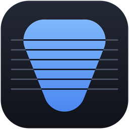

<p align="center"></p>

# NeoGuitar

A **Guitar Pro** tab reader, viewer and player written in Rust, with a UI built on [egui](https://github.com/emilk/egui).

## Features

- **Formats:** GP3, GP4, GP5, GP6 (`.gpx`) and GP7/8 (`.gp`). The format is detected from the file contents.
- **Tablature and standard notation** (Bravura music font): ties, stems and beams, rests, key signatures, chord diagrams and lyrics.
- **Expressive techniques:** bends, tremolo bar, slides, hammer-ons/pull-offs, vibrato, harmonics, trills, grace notes, tremolo picking, dead notes and let ring.
- **Playback** with a SoundFont (`.sf2`): repeats and alternate endings, tempo changes, swing, pitch bend, per-track solo / mute / volume, metronome, count-in, measure loop, adjustable speed and a **speed trainer** (raises the tempo on every pass of the loop).
- **Transposition** of the sound (±12 semitones): the tab stays the same (like a capo or a different tuning) and the staff follows the new pitch.
- **Track mixer:** instrument (all 128 General MIDI sounds), pan and reverb per track, applied live.
- **Virtual fretboard:** shows the sounding notes on the guitar neck.
- **Sections:** jump to Intro, Verse, Chorus… from the markers stored in the file.
- **Lyrics:** search [LRCLIB](https://lrclib.net) (only when you press the button: it sends the title and artist) or load an `.lrc` / `.txt` file. The current line is highlighted and follows the playback; the lyric times are used as they are (tick “Stretch to song length” to scale them to the tab) and you can pin any line to the playback position (right-click) to resync it. Shown in a side panel, or as a strip under the score in split view.
- **Multi-track view:** several tracks stacked in the same system.
- **Split view:** two tracks side by side (e.g. guitar and bass), each with its own selector. **Full screen** (F11) hides the toolbar and side panel.
- **Rehearsal playlist** (button in the toolbar, sidebar on the right): a list of tabs, each remembering which tracks play, their volumes, speed, metronome, count-in, loop and transposition. Add tabs from disk or the open tab, reorder them, and it moves on to the next tab by itself when one ends. Saved as a `.ngpl` text file you can copy to another PC together with the tabs.
- **Audio output** (More menu): choose the output device and a separate one for the metronome and count-in only, e.g. monitor headphones for the players, with the channel pair and a sync offset.
- **Export:** audio (WAV), MIDI and plain-text tab.
- Persistent settings (zoom, speed, recent files, SoundFont…).

## Installation

Download the installer (`NeoGuitar-x.y.z-setup.exe`) or the portable zip from [Releases](https://github.com/Fiambre/NeoGuitar/releases). The installer does not need administrator rights (you can choose to install for all users) and has an optional checkbox to **associate .gp3, .gp4, .gp5, .gpx and .gp files with NeoGuitar**. You can also do that later from the app: **More → Associate Guitar Pro files**.

**Updates:** on startup (at most once a day) NeoGuitar asks GitHub for the latest release and shows an **Update** button if there is a newer one. For copies installed with the installer, the button downloads the new installer from this repository's releases, verifies its SHA-256 checksum (published by GitHub) and runs it silently; NeoGuitar closes and reopens by itself. Portable copies only get a link to the release page. You can turn the check off or run it by hand in **More**. The request is anonymous: it sends nothing about you.

The installer is not code-signed, so Windows SmartScreen will warn about an unknown publisher: click “More info” and then “Run anyway”.

## Build and run

Requires [Rust](https://rustup.rs) (2024 edition).

```
cargo run --release -- file.gp5
```

You can also open a file from the app (Ctrl+O) or drag it onto the window.

### SoundFont

The repository includes [GeneralUser GS](https://schristiancollins.com/generaluser.php) in the repository's `soundfonts/` folder (license in `soundfonts/LICENSE-GeneralUser-GS.txt`), so audio works out of the box. NeoGuitar looks for a `.sf2` in a `soundfonts/` folder next to the executable or the working directory, or in the `NEOGUITAR_SOUNDFONT` environment variable; you can also pick another one from **More → Choose SoundFont…**.

### Shortcuts

| Key | Action |
|---|---|
| `Space` | Play / pause |
| `Home` | Stop and go back to the start |
| `F11` / `Esc` | Enter / leave full screen |
| `M` | Metronome |
| `Ctrl+O` | Open a file |
| Right-click a measure | Set the loop |

## Tests

```
cargo test --release
```

`samples/extra/` (at the repository root) contains test files from [PyGuitarPro](https://github.com/Perlence/PyGuitarPro), and `crates/neoguitar-core/tests/reference.rs` compares our parser against that reference implementation (`crates/neoguitar-core/tests/fixtures/dump_ref.py` regenerates the data).
Song tabs used by some other tests are not included because of copyright; those tests are skipped when the files are missing.

## Releasing a version

Pushing a `vX.Y.Z` tag triggers the *Release (Windows)* workflow (`.github/workflows/release-win.yml`): it runs the tests, builds, creates the installer with [Inno Setup](https://jrsoftware.org/isinfo.php) (`installer/neoguitar.iss`) and a portable zip, and attaches both to a GitHub release. The *CI* workflow builds and tests on every push and pull request.

```
git tag v0.1.0
git push origin v0.1.0
```

## License and credits

NeoGuitar is distributed under **LGPL-2.1 or later** (see `LICENSE`).

- The GP3–GP7 readers (`crates/neoguitar-core/src/gp.rs` and `gpx.rs`) are a Rust adaptation of the code from [TuxGuitar](https://github.com/helge17/tuxguitar) (LGPL).
- [Bravura](https://github.com/steinbergmedia/bravura) notation font (SIL Open Font License, see `assets/fonts/OFL.txt`).
- Test files from [PyGuitarPro](https://github.com/Perlence/PyGuitarPro) (LGPL-3.0).
- [GeneralUser GS](https://schristiancollins.com/generaluser.php) SoundFont by S. Christian Collins (its own license, which allows use and redistribution in software projects).
- Synthesis with [rustysynth](https://github.com/sinshu/rustysynth), audio with [cpal](https://github.com/RustAudio/cpal).

## Find tabs online (optional plugin)

`More ▸ Find tabs online…` opens a search window. The search and download code is **not** part of NeoGuitar: it is a separate program, [gprotab](https://github.com/Fiambre/GTabs-Downloader), that you install from that window if you want it (a checkbox asks you to confirm). NeoGuitar downloads it from the project's releases, checks its SHA-256 and keeps it in `%APPDATA%\NeoGuitar\plugins`. "Remove plugin" deletes it. Tabs are the work of their authors: use them for your own practice and respect their copyright.